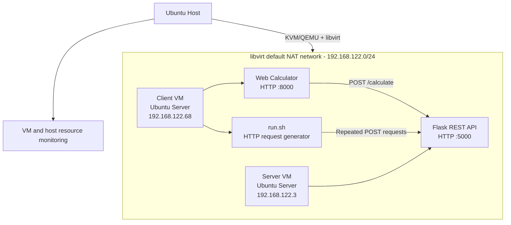

# VM-Based Calculator & Resource Monitoring

A distributed calculator application deployed across two Ubuntu Server virtual machines using **KVM/QEMU + libvirt**. The client VM hosts a browser-based calculator and request-generation script; the server VM exposes a Flask REST API that performs arithmetic operations.

> **Implementation status:** The two-VM calculator, HTTP communication, request generator, and VM resource monitoring have been demonstrated. Automatic provisioning/launch of a secondary VM when a request threshold is crossed is **not implemented in this version**. The repository name reflects the assignment direction; this README distinguishes completed work from future scope.

## Table of contents

- [Project overview](#project-overview)
- [Architecture](#architecture)
- [Environment](#environment)
- [Repository layout](#repository-layout)
- [Features](#features)
- [Network configuration](#network-configuration)
- [Run the project](#run-the-project)
- [API reference](#api-reference)
- [Load generation](#load-generation)
- [Resource monitoring](#resource-monitoring)
- [Validation and evidence](#validation-and-evidence)
- [Limitations and future work](#limitations-and-future-work)

## Project overview

The project demonstrates a small distributed application deployed on two virtual machines connected through the libvirt default NAT network.

1. A **Server VM** runs a Python Flask API on TCP port 5000.
2. A **Client VM** serves the calculator web interface and runs a shell script that sends repeated HTTP requests to the API.
3. The host machine manages both VMs using KVM/QEMU and libvirt.
4. VM memory allocation and host resource usage are inspected using libvirt and Linux monitoring commands.

The browser interface sends arithmetic operations to the server over HTTP. The server validates the input, performs the operation, and returns a JSON response.

## Architecture



The IP addresses above are the values observed during the lab. DHCP leases can change after reboot; verify current addresses before starting the application.

## Environment

| Component | Observed configuration |
|---|---|
| Host OS | Ubuntu Linux (dual-boot host) |
| Virtualization | KVM/QEMU, libvirt, Virtual Machine Manager |
| Client VM | Ubuntu Server, 1 vCPU, 1 GiB configured RAM |
| Server VM | Ubuntu Server, 2 vCPU, 2 GiB maximum RAM; live target was reduced to 1.5 GiB during resource testing |
| Virtual network | libvirt default NAT, `192.168.122.0/24` |
| Backend | Python 3, Flask, Flask-CORS |
| Frontend | HTML, CSS, JavaScript |
| Communication | HTTP, JSON, TCP |

The host is a resource-constrained laptop (8 GB physical RAM). VM memory settings used in the experiment should be treated as environment-specific, not universal recommendations.

## Repository layout

```text
.
├── README.md
├── .gitignore
├── client/
│   ├── index.html
│   └── run.sh
├── server/
│   ├── app.py
│   └── requirements.txt
├── docs/
│   ├── architecture.md
│   ├── setup-and-testing.md
│   └── screenshots.md
├── report/
│   ├── Cloud_Computing_Project_Report.pdf
│   └── Cloud_Computing_Project_Report.docx
└── screenshots/
    └── (actual lab screenshots)
```

Some files/directories are planned and will be added after the source files and original evidence are collected from the VMs. Do not treat this illustrative tree as proof that every file is already present.

## Features

### Implemented and tested

- Two Ubuntu Server VMs managed by KVM/QEMU and libvirt.
- Flask REST API hosted on the Server VM and bound to `0.0.0.0:5000`.
- Browser-based calculator hosted on the Client VM at port 8000.
- Client-to-server communication over the libvirt virtual network.
- Addition, subtraction, multiplication, and division API operations.
- JSON request and response handling.
- Input validation and division-by-zero handling.
- Shell-based repeated request generation from the Client VM.
- VM memory inspection and live memory-target adjustment using `virsh`.

### Not implemented in this version

- Automatic threshold detection that provisions or starts a secondary VM.
- Load balancer or traffic distribution across multiple server VMs.
- Automatic scale-in/VM shutdown policy.

## Network configuration

| Node | Observed IP | Service |
|---|---:|---|
| Server VM | `192.168.122.3` | Flask API, TCP 5000 |
| Client VM | `192.168.122.68` | Frontend HTTP server, TCP 8000 |

Check the current addresses on the host:

```bash
sudo virsh domifaddr calculator-server
sudo virsh domifaddr calculator-client
```

If the addresses have changed, update the API base URL in the frontend and in `client/run.sh` before testing.

## Run the project

### 1. Start the virtual machines

On the Ubuntu host:

```bash
sudo virsh start calculator-server
sudo virsh start calculator-client
sudo virsh list --all
```

If a VM is already running, `virsh start` may report that it is already active; this is harmless.

### 2. Start the backend (Server VM)

Connect from the host:

```bash
ssh <server-user>@<server-vm-ip>
```

Then:

```bash
cd ~/calculator-server
python3 app.py
```

The API should listen on `0.0.0.0:5000`. Keep this terminal running.

### 3. Start the frontend web server (Client VM)

Connect from the host:

```bash
ssh <client-user>@<client-vm-ip>
```

Then:

```bash
cd ~
python3 -m http.server 8000 --bind 0.0.0.0
```

Keep this terminal running. Open the client VM address in a browser on the host:

```text
http://<client-vm-ip>:8000
```

The frontend must point to the current server API address, for example `http://192.168.122.3:5000`.

### 4. Verify the API

From the host or Client VM:

```bash
curl http://<server-vm-ip>:5000/
```

Example calculation request:

```bash
curl -X POST http://<server-vm-ip>:5000/calculate \
  -H 'Content-Type: application/json' \
  -d '{"a":10,"b":5,"operation":"add"}'
```

Expected result for the example: `15.0`.

## API reference

### `GET /`

Health/status endpoint. Returns a JSON status message.

### `POST /calculate`

Request body:

```json
{
  "a": 10,
  "b": 5,
  "operation": "add"
}
```

Supported operation values:

| Operation | Meaning |
|---|---|
| `add` | Addition |
| `subtract` | Subtraction |
| `multiply` | Multiplication |
| `divide` | Division |

A successful response contains the calculation result. Invalid input and division by zero should return an error response.

## Load generation

The Client VM request generator is located at `client/run.sh` in the repository (the working VM copy was at `~/calculator-client/run.sh`).

Usage:

```bash
chmod +x run.sh
./run.sh 6
```

The argument specifies the number of sequential HTTP requests. The demonstrated run with six requests returned six successful addition results (10 + 5 = 15.0), and the Server VM Flask terminal showed the corresponding incoming POST requests.

This script generates sequential requests; it is not a concurrent load-testing benchmark and does not itself implement autoscaling.

## Resource monitoring

Useful host commands:

```bash
free -h
swapon --show
df -h /
sudo virsh list --all
sudo virsh dominfo calculator-server
sudo virsh dommemstat calculator-server
sudo virsh dominfo calculator-client
sudo virsh dommemstat calculator-client
```

A live memory target can be adjusted with `virsh setmem` when the guest supports the virtio balloon device. During this lab, the Server VM's live target was changed from 2 GiB to 1.5 GiB and the API remained responsive. This is a manual resource-management experiment, not an automatic scaling controller.

## Validation and evidence

The following checks were completed during the lab:

- Both VMs were running under libvirt.
- Client-to-server network reachability was verified.
- Flask health endpoint returned a running status.
- Browser calculator successfully received calculation results.
- Client request generator sent six requests successfully.
- Flask access logs showed the incoming requests.
- VM memory statistics and host memory/swap were inspected.

Place original, unedited screenshots in `screenshots/`. See [docs/screenshots.md](docs/screenshots.md) for the evidence checklist.

## Limitations and future work

1. Implement a request counter or metrics endpoint with a defined threshold and time window.
2. Add a host-side autoscaling controller with least-privilege libvirt access.
3. Provision a separate secondary server VM from a clean cloud image or reproducible template.
4. Add a reverse proxy/load balancer and health checks to distribute traffic.
5. Implement scale-in, cooldown, failure handling, and duplicate-trigger protection.
6. Run concurrent load tests and record latency, throughput, and resource utilization.
7. Add automated tests for all arithmetic operations and error cases.

## Academic note

This repository documents the implementation and observations from a Cloud Computing lab. Update the report with the course's exact assignment wording, instructor details, submission date, and original screenshots before final submission.
