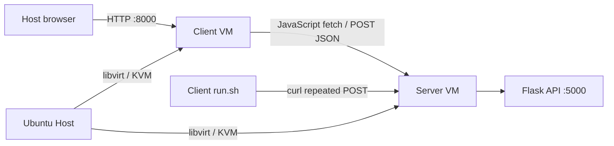

# Architecture and Network Design

## Deployment model

The lab uses two separate Ubuntu Server guests on the libvirt default NAT network.

- **Client VM:** hosts the static calculator page and the shell request generator.
- **Server VM:** hosts the Flask REST API.
- **Host:** manages both guests through KVM/QEMU and libvirt, and is used to inspect VM and host resources.

## Logical topology

## Observed network values

| Component | Observed address | Port |
|---|---|---:|
| libvirt default network | 192.168.122.0/24 | — |
| Server VM | 192.168.122.3 | 5000 |
| Client VM | 192.168.122.68 | 8000 |

These addresses are observations from the lab session, not static reservations. Re-check DHCP leases after reboot.

## Request flow

1. A user opens the calculator page served by the Client VM.
2. The page sends an HTTP POST request containing operands and an operation.
3. The Flask API validates the JSON payload.
4. The API executes the requested arithmetic operation.
5. The API returns a JSON result or an error response.
6. Separately, `run.sh` can issue a specified number of sequential API requests from the Client VM.

## Virtualization and resource management

The host uses libvirt to manage VM lifecycle and inspect memory statistics. The Server VM's live memory target was adjusted to 1.5 GiB during the experiment. This was a manual change and did not constitute an automated scale-out event.

## Scaling boundary

The assignment's VM-level scale-out goal is future work in this repository state. No second server VM was provisioned or automatically started. Application-level repeated requests and manual VM resource adjustment must not be represented as VM autoscaling.
